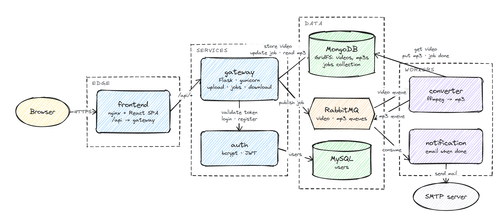
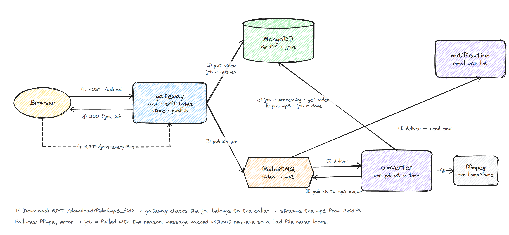
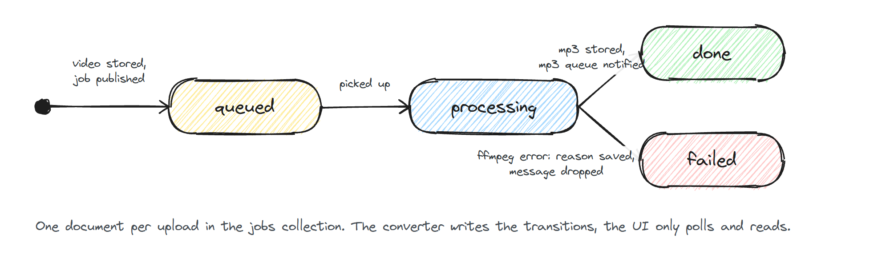
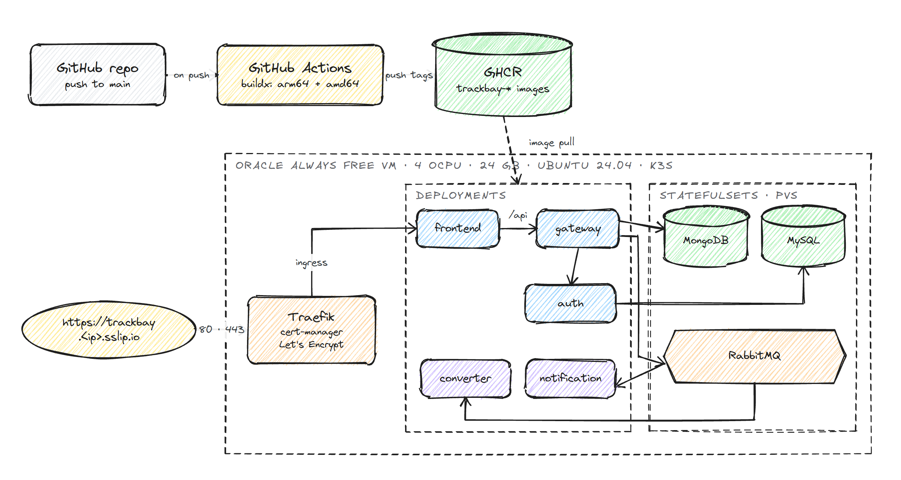

# Trackbay

Trackbay is an event-driven microservice application: upload a video, a worker extracts the
audio with ffmpeg, and you get an MP3 back (plus an email when it is ready).
Built to practise microservice patterns: an API gateway, a dedicated auth
service, asynchronous work over RabbitMQ, object storage in MongoDB GridFS,
and a React frontend, all containerised and deployable to Kubernetes.

## Architecture

### System overview



The browser only ever talks to nginx. It serves the React build and proxies `/api/*` to the
gateway, which is the single public API. The gateway hands credentials to the auth service,
keeps uploads and results in MongoDB GridFS, records every conversion in a `jobs` collection
and publishes work to RabbitMQ. Two workers consume from the queues: the converter runs
ffmpeg, the notification worker emails a download link.

### Conversion flow



The upload request returns as soon as the video is stored and the job is queued, so the user
never waits on ffmpeg. The page polls `/jobs` every few seconds and flips the row from queued
to processing to done. The converter takes one message at a time; a message is only
acknowledged after the mp3 is stored and the job updated, so a crash mid-conversion requeues
the work instead of losing it.

### Job lifecycle



### Deployment



For development the whole stack runs under one `docker compose` project. The same services
also run on Kubernetes from `deploy/k8s`: today on a k3d cluster on a laptop behind a
Cloudflare tunnel, and unchanged on a k3s VM such as the Oracle Always Free target pictured
above. See [Deploying](#deploying).

The diagrams are Excalidraw files in [`docs/diagrams/`](docs/diagrams/); open any
`.excalidraw` file at [excalidraw.com](https://excalidraw.com) to edit it.

## Services

| Service | Stack | Role |
|---|---|---|
| `frontend/` | React, Vite, Tailwind v4, nginx | Sign in, drag-and-drop upload, live job list, download. nginx proxies `/api` to the gateway. |
| `src/gateway` | Flask, gunicorn | Public API. Validates JWTs via auth, stores uploads in GridFS, records jobs, publishes to RabbitMQ, serves downloads. |
| `src/auth` | Flask, gunicorn, PyMySQL, bcrypt | Login (HTTP Basic) and JWT issue/validate. Creates its table and seeds a demo user on startup. |
| `src/converter` | Python, pika, ffmpeg | Consumes `video` queue, extracts audio to MP3, updates job status, publishes to `mp3` queue. |
| `src/notification` | Python, pika, smtplib | Consumes `mp3` queue, emails the user. Logs instead if SMTP is not configured. |
| MongoDB, MySQL, RabbitMQ | official images | Storage, users, messaging. |

### API (gateway)

All responses are JSON. Authenticated routes need `Authorization: Bearer <token>`.

| Method | Path | Description |
|---|---|---|
| `GET` | `/health` | Liveness, checks MongoDB. |
| `POST` | `/login` | HTTP Basic credentials, returns `{"token": "..."}`. |
| `POST` | `/register` | JSON `{"email", "password"}` (8+ chars). Creates the account and returns `{"token": "..."}`; `409` if the email exists. |
| `POST` | `/upload` | Multipart field `file`. Returns `{"job_id", "video_fid", "filename", "status"}`. `400` if empty, `413` if over `MAX_UPLOAD_MB`, `415` if the content is a web page or plain text rather than media. |
| `GET` | `/jobs` | The caller's jobs, newest first. Status is `queued`, `processing`, `done` or `failed`. |
| `GET` | `/jobs/<id>` | One job. |
| `GET` | `/download?fid=<mp3_fid>` | The MP3 as an attachment. Only the owner can download. |

## Run locally

Requirements: Docker Desktop (with Compose v2).

```bash
cp .env.example .env
# edit .env: set MYSQL_ROOT_PASSWORD, MYSQL_PASSWORD, JWT_SECRET, DEMO_USER_PASSWORD
# optionally SMTP_USER / SMTP_PASSWORD (Gmail app password) for email

docker compose up --build -d
docker compose ps
```

| What | URL |
|---|---|
| App | http://localhost:3000 |
| Gateway API | http://localhost:8080 |
| RabbitMQ management | http://localhost:15672 (RABBITMQ_USER / RABBITMQ_PASSWORD) |

Sign in with `DEMO_USER_EMAIL` / `DEMO_USER_PASSWORD` from your `.env`.

### End-to-end smoke test

Generate a small test video (3 seconds, tone plus colour) using the ffmpeg inside the converter image, then run the test script:

```bash
docker compose run --rm --no-deps -v "$PWD/scripts:/out" converter \
  ffmpeg -y -f lavfi -i "sine=frequency=440:duration=3" -f lavfi -i "color=c=teal:s=320x240:d=3" \
  -shortest -c:v libx264 -pix_fmt yuv420p -c:a aac /out/sample.mp4

python scripts/smoke_test.py scripts/sample.mp4
```

The script logs in, uploads, polls the job until `done`, downloads the MP3 and saves it next to the input.

### Frontend development

```bash
cd frontend
cp .env.example .env        # GATEWAY_URL=http://localhost:8080
npm install
npm run dev                 # http://localhost:3000, /api proxied to the gateway
```

### Logs and troubleshooting

```bash
docker compose logs -f gateway converter notification auth
docker compose exec mongodb mongosh mp3converter --eval "db.jobs.find().sort({created_at:-1}).limit(5)"
```

- Every service waits for its dependencies at startup and retries, so a slow database is not an error.
- Queues are declared durable by both producers and consumers; nothing needs to be created by hand in RabbitMQ.
- A message that cannot be processed is rejected without requeue (and the job is marked `failed`) so it cannot loop forever.

## Configuration

Each service documents its environment variables in `src/<service>/.env.example`.
The root `.env.example` feeds `docker-compose.yml`. Nothing secret is committed:
the demo user is seeded from env and stored bcrypt-hashed, and the JWT secret
must be at least 16 characters.

## Deploying

The Kubernetes manifests live in [`deploy/k8s`](deploy/k8s) and are applied with kustomize:

- **StatefulSets** with persistent volumes for MongoDB, MySQL and RabbitMQ.
- **Deployments** for the five services, each with startup, readiness and liveness probes and resource limits.
- **One Traefik Ingress** in front of the frontend; nginx inside the frontend pod proxies `/api` to the gateway Service.
- **No secrets in git.** The `trackbay-secrets` Secret is created from your `.env` at deploy time, and each pod only receives the keys it uses.

### On a laptop, with a public link (k3d + Cloudflare Tunnel)

This runs the real Kubernetes setup on k3s inside Docker and publishes it on an HTTPS
`trycloudflare.com` address. No cloud account is needed; the laptop just has to stay awake.

Requirements: Docker Desktop, kubectl and k3d (`winget install -e --id k3d.k3d`). The tunnel
script downloads `cloudflared` on first use and checks its Cloudflare signature.

```powershell
# build the images, create the cluster, deploy, wait for every pod (re-run after code changes)
powershell -ExecutionPolicy Bypass -File deploy\local\up.ps1

# public HTTPS link; keep the window open, Ctrl+C stops it
powershell -ExecutionPolicy Bypass -File deploy\local\tunnel.ps1

# stop the cluster but keep its data, or delete it entirely
powershell -ExecutionPolicy Bypass -File deploy\local\down.ps1
powershell -ExecutionPolicy Bypass -File deploy\local\down.ps1 -Delete
```

| What | Where |
|---|---|
| App on Kubernetes | http://localhost:8088 |
| Public link | Printed by `tunnel.ps1`; a new address each time the tunnel starts |
| RabbitMQ management | `kubectl -n trackbay port-forward svc/rabbitmq 15672`, then http://localhost:15672 |

Handy during a demo:

```bash
kubectl -n trackbay get pods
kubectl -n trackbay logs -f deploy/converter
kubectl -n trackbay scale deploy/converter --replicas=3    # convert several videos in parallel
```

Quick tunnels are meant for demos: there is no uptime guarantee and Cloudflare caps a single
upload at about 100 MB. Start the tunnel shortly before you share the link.

### On a VM

The same manifests run on any single k3s node, for example an Oracle Cloud Always Free ARM VM:

1. Install k3s: `curl -sfL https://get.k3s.io | sh -`
2. Push the five images to a registry and point the `images:` block in `deploy/k8s/kustomization.yaml` at it.
3. Create the Secret from a file holding `MYSQL_ROOT_PASSWORD`, `MYSQL_PASSWORD`, `JWT_SECRET`,
   `RABBITMQ_USER`, `RABBITMQ_PASSWORD`, `RABBITMQ_URL` and optionally the `DEMO_USER_*` and `SMTP_*` keys:
   `kubectl create namespace trackbay && kubectl -n trackbay create secret generic trackbay-secrets --from-env-file=secrets.env`
4. Apply: `kubectl apply -f deploy/k3s/traefik-config.yaml && kubectl apply -k deploy/k8s`

## Design notes

- **Why a jobs collection?** The original design only told the user about a finished MP3 by email. Recording each job in MongoDB lets the UI poll status and gives downloads an ownership check.
- **Why ffmpeg directly instead of moviepy?** moviepy pulled in numpy, Pillow and imageio and loaded whole videos through Python. Calling ffmpeg as a subprocess is faster, uses a fraction of the memory, and shrinks the image considerably.
- **Why one RabbitMQ connection per publish in the gateway?** The gateway runs several gunicorn workers and sees sparse traffic. A shared long-lived connection dies quietly on missed heartbeats, which was the main source of failed uploads. Short connections are simpler and reliable at this scale.
